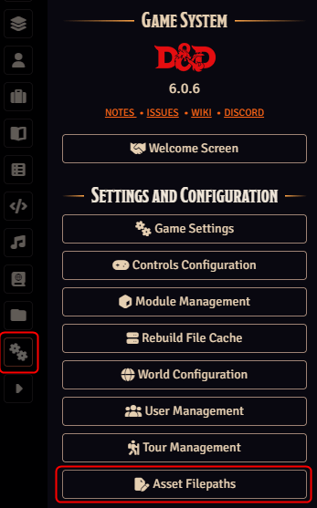
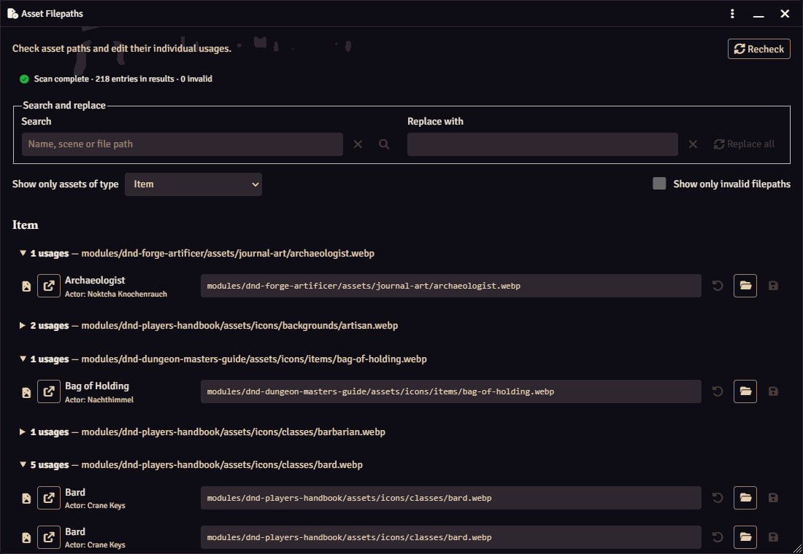
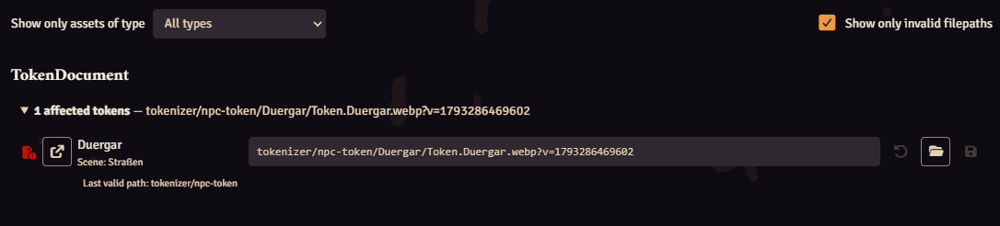
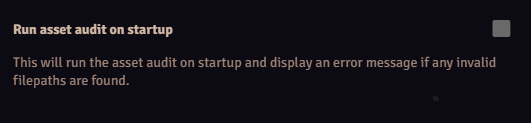

# Asset Auditor

Asset Auditor helps Foundry Virtual Tabletop GMs find and repair broken references
to images, maps and audio. It brings file validation, document navigation and path
editing into one overview, making asset reorganizations easier to review.

## Features

- **Resizable audit window:** fixed search and filter tools with a separately
  scrolling result list.
- **Visible scan progress:** directory, reference and repair-hint counters, followed
  by completion, empty-result or retry feedback.
- **User Data and Core Data checks:** local references are compared with server
  directory listings, preserving filename case and accounting for URI encoding.
- **Grouped usages:** exact paths are grouped by document type, with scene, actor,
  playlist and journal names identifying each usage.
- **Direct navigation:** open the document or configuration associated with a
  reference, including prototype tokens and playlist sounds.
- **Path repair:** file selection saves immediately; manual edits use Save or Reset.
  Each repaired row is revalidated while other row drafts remain available.
- **Wildcard feedback:** matching-file counts and a reminder before selecting a
  single file in place of a pattern.
- **English and German localization.**

## Usage

Enable the module and open **Asset Filepaths** from the Settings sidebar. The
button is available to the GM and Assistant GM roles.



The window displays progress while the audit runs, then shows its result summary.
Use **Recheck** to repeat the audit. Search, filter changes and Recheck rebuild the
list from saved document data, so save any path drafts you want to keep first.
Closing the window during a scan keeps it closed; reopening starts a fresh check.

### Find the affected usage

Results are organized by document type and exact file path. Expand a group to see
its individual usages. Context labels distinguish similarly named objects across
scenes and other parent documents. **Open original** opens the associated editor.



The overview combines the scan summary and filters with expandable usage groups.
Each entry identifies its parent and provides controls for opening the original,
choosing a file and editing its path.

Missing paths show a warning icon and the last valid parent directory. Enable
**Show only invalid filepaths** to focus on references requiring attention.
Wildcard entries show the number of distinct matching file URLs; zero matches
identify a pattern requiring repair.

### Repair a reference

Choosing a file in the browser **saves immediately**. For manual path edits, use
**Save** or **Reset** on the affected row. Each successful save triggers a fresh
validation, and repaired entries disappear from the invalid-only results.



The invalid-only view shows the affected scene and the last valid directory,
providing the context needed to locate a replacement file.

Selecting an individual file for a wildcard reference replaces its pattern. The
picker displays a reminder before selection. To retain a pattern, edit its folder
or expression in the path field and save manually.

### Search and replace

**Search** filters by document name, path or parent name. Submit a query using its
button or Enter. **Replace all** applies the replacement to the current result set
when a search term is provided. Back up the world before bulk changes. If a
replacement stops partway through, use **Recheck** to review the saved results.

Both input fields can be cleared with their clear button or Escape. Enter in the
replacement field runs the replacement, just as its button does.

### Check paths when the world starts

Open Foundry's settings configuration, find Asset Auditor under **Module Settings**
and enable **Run asset audit on startup**. When a GM or Assistant GM loads the
world, the check reports the number of invalid references in a notification.



### External URLs

Paths beginning with `http://` or `https://` receive a best-effort network
reachability check, cached by origin. Browser cross-origin restrictions make this
a domain-level indicator; the local file checks use the directory listings from
User Data and Core Data.

## Development and validation

Use Node.js 24 LTS (24.15 or later) for development. The test suite imports the
actual audit modules and exercises the Handlebars template and DOM handlers in
jsdom with simulated Foundry APIs.

```sh
npm ci --ignore-scripts
npm test
npm run check
```

GitHub Actions runs these checks on Linux and Windows. The source check validates
UTF-8 text and JavaScript syntax across `src/`; metadata tests check registered
translations, interpolation parameters, release versions and manifest file paths.
The repository's existing consistency workflows also check release metadata and
localization usage.

The [testing guide](docs/testing.md) describes the audited fields, automated test
scope and reproducible in-Foundry checks for rendering, audio and module integration.

## Manual installation

The `src/` directory contains the installable module. For a development checkout,
use a test world and back up your data first.

1. Clone or download this repository and check out the revision you want to test.
   For the contributing helper scripts, initialize the submodule with
   `git submodule update --init --recursive`.
2. Copy **the contents of `src/`** into
   `<Foundry User Data>/Data/modules/asset-auditor/`.
3. Restart Foundry, enable Asset Auditor in the world and reload the browser.
4. Open **Asset Filepaths** or follow the [manual test checklist](docs/testing.md).

### Symbolic link on Linux and macOS

For development, a symbolic link lets Foundry use the source directory directly:

```sh
ln -s "/path/to/AssetAuditor/src" "/path/to/FoundryUserData/Data/modules/asset-auditor"
```

Replace both paths with your local locations. The destination directory must be
available for the link. Restart Foundry after creating it.

## Contributing

Bug reports, feature requests and pull requests are welcome. Check the existing
[issues](https://github.com/TheComamba/AssetAuditor/issues) before opening a report
and include reproduction steps, the Foundry version and the affected document type.

To add a language, create `src/lang/<language-code>.json` using its
[two-letter ISO 639-1 code](https://en.wikipedia.org/wiki/List_of_ISO_639-1_codes)
and register it in `src/module.json`. Match the English localization keys and
interpolation placeholders. Run the consistency check used by CI:

```sh
./foundry_scripts/check_localizations_consistency.sh
```

The helper scripts are provided by the repository's `foundry_scripts` submodule
and run in a POSIX shell. Keep each contribution focused on one problem or
workflow, and include its motivation, approach and reproducible verification.

## License and attribution

Asset Auditor was created by [The Comamba](https://github.com/TheComamba/AssetAuditor).
The project is distributed under the [MIT license](LICENSE).
